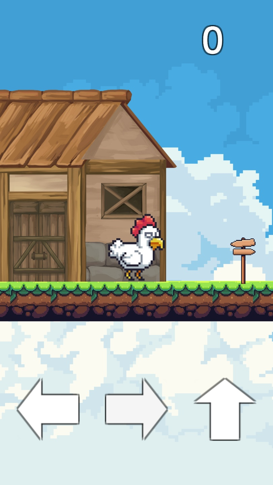
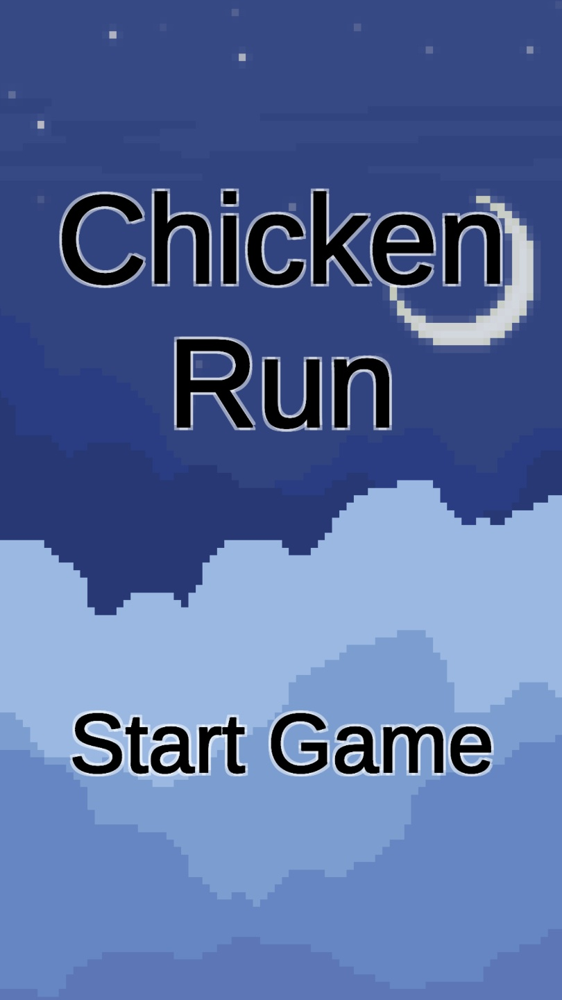

# JumpGame

동물이 집에서 도망치는 게임. 플랫포머 · 모바일(안드로이드) (Unity 학습 프로젝트).

 

## 플레이

[Releases](../../releases)에서 `JumpGame-<버전>-android.apk`를 받아 설치. 처음 설치 시 "출처를 알 수 없는 앱" 허용 필요.

화면 하단의 화살표를 터치하면 캐릭터가 이동하는 방식으로 진행할 수 있습니다.
플랫폼 끝의 표지판에 캐릭터가 닿으면 다음 플랫폼이 생성되며 점수가 올라갑니다.
플랫폼에서 떨어지면 게임 오버되고 최고 기록보다 높다면 최고 기록을 갱신합니다.

## 제작 노트

처음으로 직접 구상하고 제작한 유니티 게임입니다.
초기에는 게임을 진행 중 코인을 얻고, 코인으로 새로운 동물을 구매하는 방식을 고려했으나 구현 방식을 떠올릴 수 없어 초안을 수정했습나다.
이후 맵을 일일이 구성하면 맴 길이가 제한이 되기 때문에 대신 랜덤으로 무한히 생성되는 것이 더 재미있겠다고 생각했고, 이를 구현하는 데에 가장 큰 시간을 소모했습니다.
